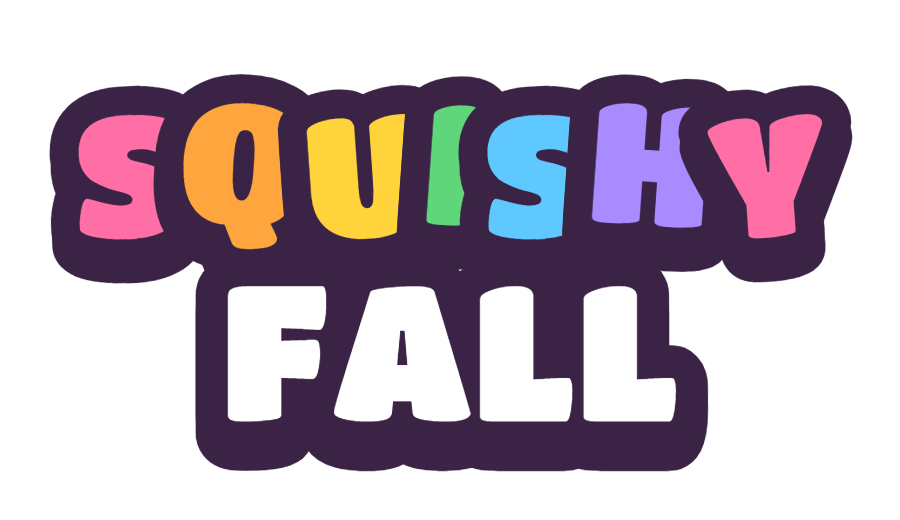
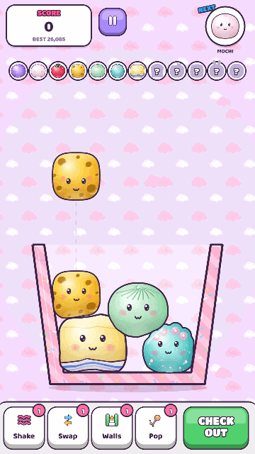
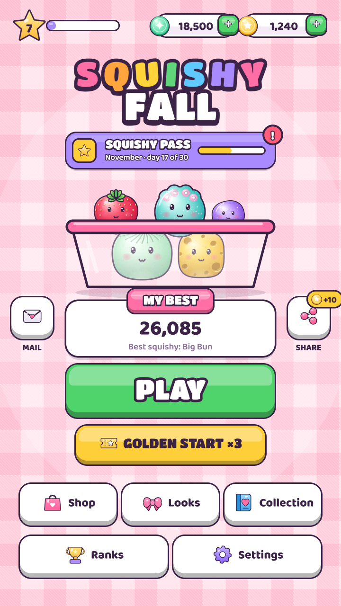
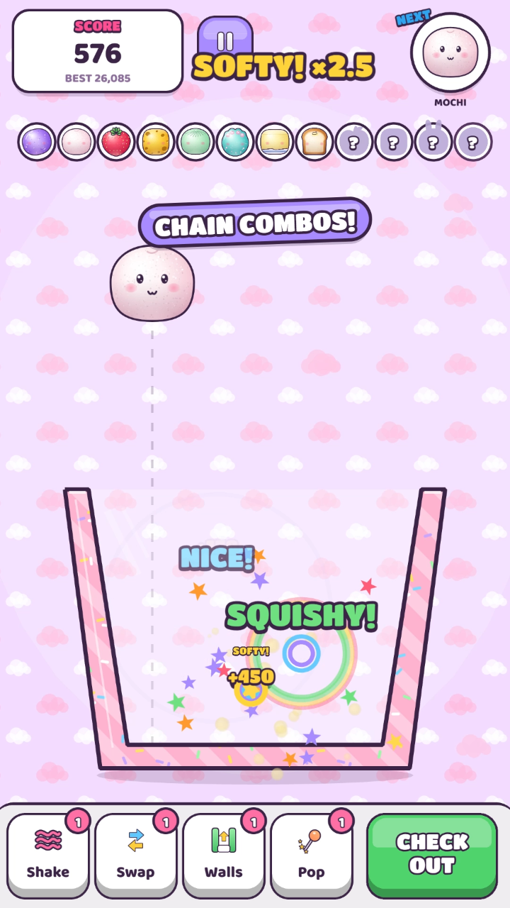
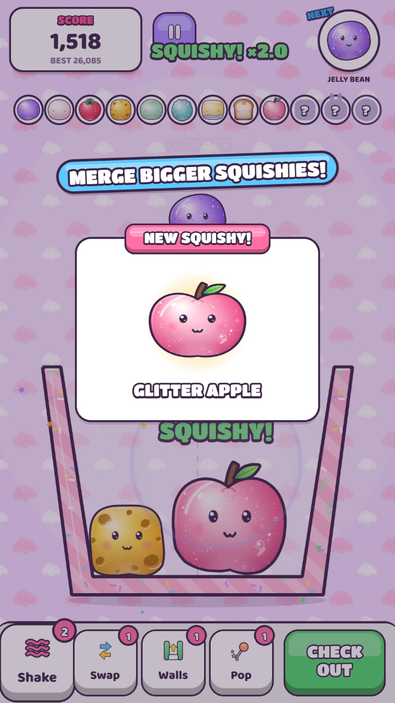
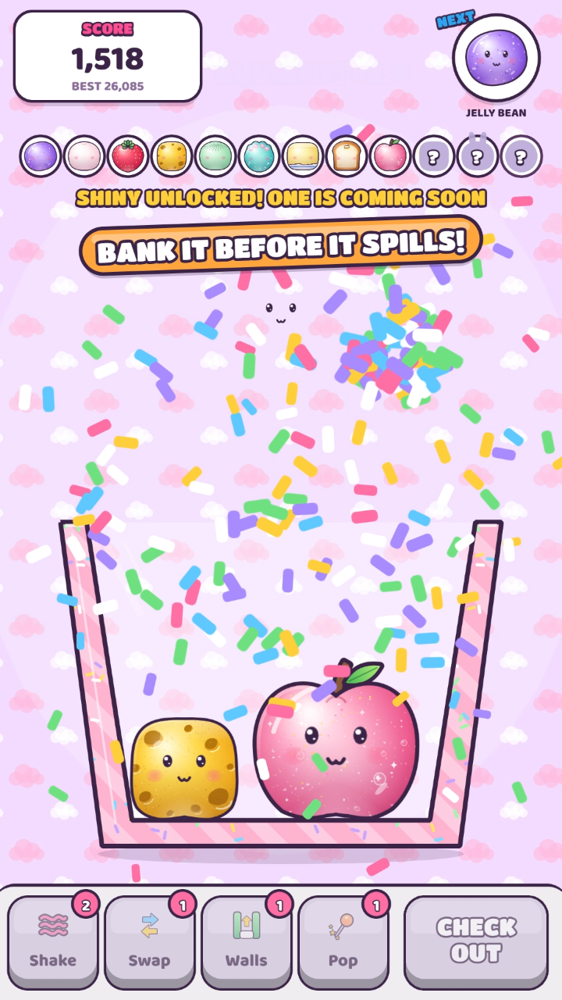
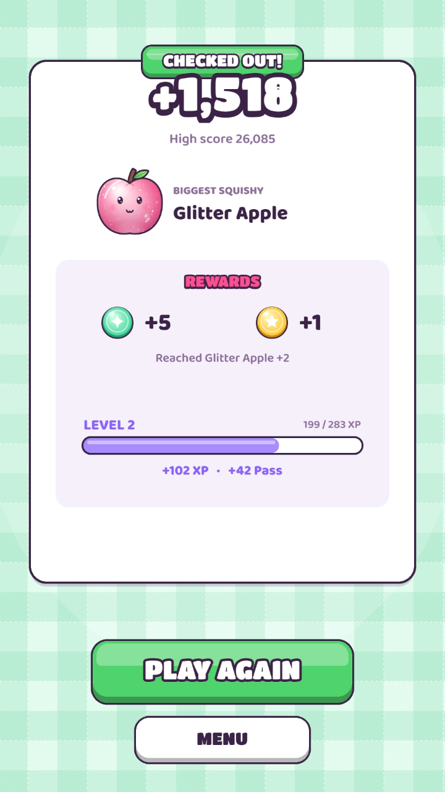
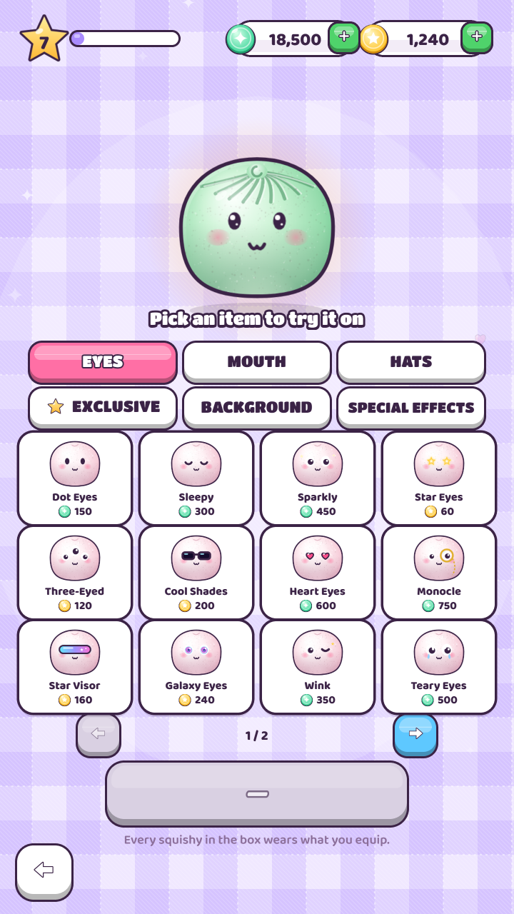
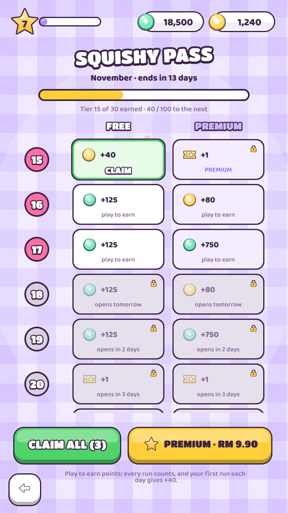
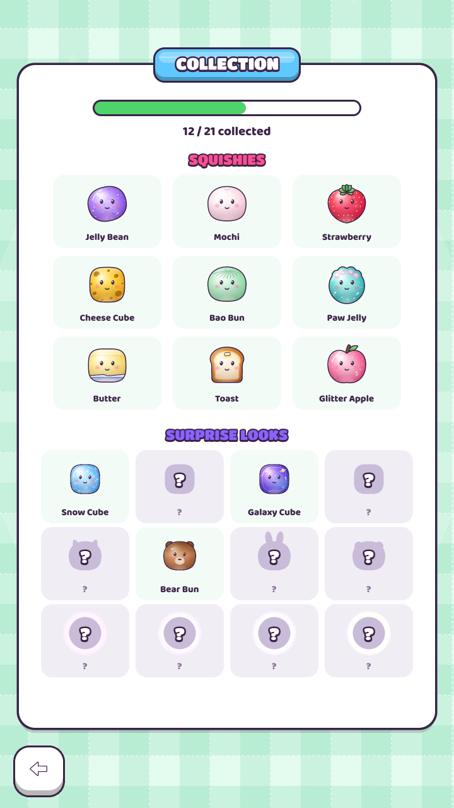

<p align="center">
  
</p>

<p align="center">
  <b>Drop. Squish. Merge!</b><br>
  A cozy physics merge game about stacking soft, squishy snacks, playable free in your browser.
</p>

<p align="center">
  <a href="https://amirsams.itch.io/squishy-fall"><b>▶ Play on itch.io</b></a>
  &nbsp;·&nbsp;
  <a href="https://squishy-fall.netlify.app"><b>▶ Play on the web (phones: Add to Home Screen)</b></a>
</p>

<p align="center">
  
</p>

> This is a showcase page. The game's source code is kept private.

---

## About the game

Drop squishies into the box. When two of the same squishy touch, they merge into a bigger one: Jelly Bean → Mochi → Strawberry → … → Glitter Apple and beyond. Every squishy is soft-body-ish, so the pile wobbles, squishes and shifts as it grows.

The twist: **bank it before it spills.** Check Out any time to keep your score and rewards, or push your luck for a bigger chain. If the box overflows, the run is lost.

## Features

- **Squishy merging physics.** Squash-and-stretch bodies, chain reactions and combo multipliers ("NICE!", "SQUISHY!", "SOFTY! ×2.5").
- **Push your luck.** Check Out to bank a run, with a Second Chance when the box spills.
- **Power-ups.** Shake, Swap, Walls and Pop.
- **Collection.** 9 squishies plus rare surprise looks and shiny drops to discover.
- **80+ cosmetics.** Eyes, mouths, hats, exclusives, gameplay backgrounds and merge-pop special effects, all drawn in code.
- **Squishy Pass.** A monthly season: one tier opens each day, playing earns it, with free and premium tracks.
- **Online leaderboard**, plus **in-game mail** for gifts and news.
- **Cloud save** with transfer codes, so progress moves between browsers and devices.
- **Share & invite rewards.** Short invite links that reward players when new friends join.
- **Player levels, daily rewards and Golden Tickets.**
- **6 languages:** English, Bahasa Melayu, Bahasa Indonesia, Español, Français, Português.
- **Phone-first.** Touch controls, haptics, and installable to the Home Screen (PWA).

## Screenshots

<p align="center">
  
  
  
  
</p>
<p align="center">
  
  
  
  
</p>

## Trailer

- [Vertical promo, 1080×1920 (20 s)](media/squishy-fall-promo-1080x1920.mp4)
- [Landscape promo, 1920×1080 (20 s)](media/squishy-fall-promo-1920x1080.mp4)

## Tech stack

| Area | Technology |
|---|---|
| Language | TypeScript |
| Game engine | [Phaser 3](https://phaser.io) |
| Physics | Matter.js (through Phaser) |
| Build | Vite, one codebase → itch.io, own website and web-portal builds |
| Tests | Vitest (110 unit tests on game rules, economy, Pass and store logic) |
| Art | Procedural: every squishy, face, hat and background is drawn in code |
| Backend | Supabase: Postgres with row-level security, and Deno edge functions |
| Online features | Leaderboard, mail, invites, cloud save, feedback, crash reports |
| Payments | Stripe Checkout, with server-side purchase verification |
| Ads | Google H5 Games Ads (web), portal ad SDKs |
| Integrations | Resend (email), TinyURL (short links) |
| Hosting | itch.io and Netlify (installable PWA) |
| Promo tooling | Custom in-browser recorder (WebCodecs + MP4 muxing), frame-perfect |

## Engineering highlights

- **Deterministic, testable game rules.** Scoring, economy, Pass progress and store logic are pure TypeScript functions, kept apart from the engine and covered by unit tests.
- **Memory-conscious on phones.** Textures are generated lazily and released after use, which cut start-up image memory from 76 MB to about 13 MB and fixed crashes on older iPhones.
- **Crash guard.** A tiny watchdog script detects boot failures, freezes and lost graphics, shows a recovery screen and reports the problem.
- **Secure server design.** Database tables are locked behind row-level security and only reachable through edge functions. Public IDs are hashed, so no internal IDs appear in links or on the leaderboard.
- **Frame-perfect trailers.** The trailers above are recorded from the real game, stepped one frame at a time and encoded in the browser.

## Code samples

A few small, self-contained pieces of the game logic.

**Combo chains:** merges within 1.5 s of each other extend the chain, and each link raises the score multiplier.

```ts
/** Merges within this window of the previous merge extend the combo chain. */
export const COMBO_WINDOW_MS = 1500;
/** Each extra link in a chain adds this much to the multiplier. */
export const COMBO_STEP = 0.5;

export function comboMultiplier(chain: number): number {
  return 1 + COMBO_STEP * Math.max(0, chain - 1);
}

export function scoreFor(basePoints: number, chain: number): number {
  return Math.round(basePoints * comboMultiplier(chain));
}

/** Returns the new chain length given the time of the previous merge. */
export function nextChain(prevChain: number, lastMergeAt: number | null, now: number): number {
  if (lastMergeAt === null || now - lastMergeAt > COMBO_WINDOW_MS) return 1;
  return prevChain + 1;
}
```

**Squishy Pass tiers:** tier N opens on day N of the month, and is claimable once the player has earned enough points by playing.

```ts
export type TierState = 'claimed' | 'claimable' | 'earn' | 'locked' | 'premium';

/** Tiers opened by the calendar: tier N opens on day N. */
export function tiersOpen(season: string, now = new Date()): number {
  const cur = seasonId(now);
  if (season < cur) return daysInSeason(season); // a past month: all open
  if (season > cur) return 0;
  return now.getDate();
}

/** State of one tier (1-based) on a track. */
export function tierState(save: SaveData, track: 'free' | 'premium', tier: number, now = new Date()): TierState {
  const p = save.pass;
  const claimed = track === 'free' ? p.claimedFree : p.claimedPremium;
  if (claimed.includes(tier)) return 'claimed';
  if (tier > tiersOpen(p.season, now)) return 'locked';
  if (tier > tiersEarned(p)) return 'earn';
  if (track === 'premium' && !hasPremium(save, p.season)) return 'premium';
  return 'claimable';
}
```

## Contact

Made by **Amir**. Feedback is welcome inside the game (Settings → Feedback), or on the [itch.io page](https://amirsams.itch.io/squishy-fall).

---

<sub>© 2026 Amir. All rights reserved. Squishy Fall, its art and its code may not be copied or redistributed.</sub>
